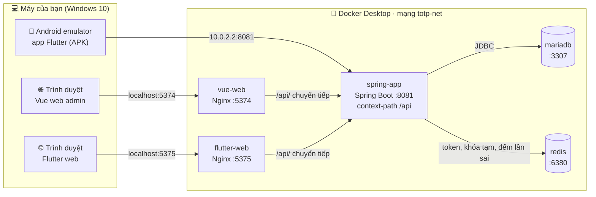
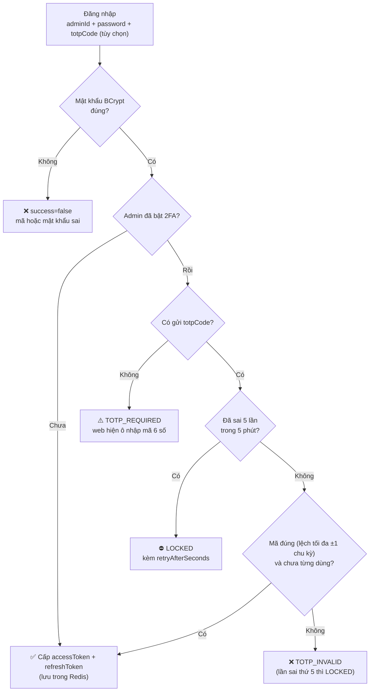
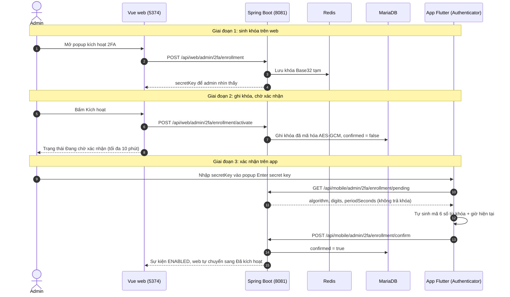

# 🔐 TOTP 2FA Authentication

Hệ thống đăng nhập quản trị viên có **xác thực 2 lớp bằng mã TOTP** (mã 6 số đổi theo thời gian, như Google Authenticator), chạy hoàn toàn bằng **Docker**.

| Thành phần | Vai trò | Công nghệ |
|---|---|---|
| `be-web-admin` | API đăng nhập, cấp/kiểm tra mã TOTP, cấp JWT | Spring Boot, MariaDB, Redis |
| `fe_web_admin` | Web quản trị: đăng nhập, bật/tắt 2FA | Vue, Vite, Nginx |
| `app_mobile` | Ứng dụng **Authenticator**: giữ khóa bí mật và sinh mã 6 số | Flutter (chạy web hoặc APK cho Android) |

## 📑 Mục lục

1. [Kiến trúc và các cổng](#-kiến-trúc-và-các-cổng)
2. [Luồng đăng nhập và kích hoạt 2FA](#-luồng-đăng-nhập-và-kích-hoạt-2fa)
3. [Yêu cầu trên Windows 10](#-yêu-cầu-trên-windows-10)
4. [Cài đặt nhanh (5 bước)](#-cài-đặt-nhanh-5-bước)
5. [Bảng lệnh của script](#-bảng-lệnh-của-script)
6. [Dùng thử 2FA từng bước](#-dùng-thử-2fa-từng-bước)
7. [Android emulator và truy cập từ máy khác](#-android-emulator-và-truy-cập-từ-máy-khác)
8. [Cấu hình `.env`](#-cấu-hình-env)
9. [Xử lý sự cố trên Windows](#-xử-lý-sự-cố-trên-windows)
10. [Cấu trúc thư mục](#-cấu-trúc-thư-mục)
11. [Lưu ý bảo mật](#-lưu-ý-bảo-mật)

---

## 🧭 Kiến trúc và các cổng



### Bảng cổng

| Cổng | Container | Mở cho | Dùng để |
|:---:|---|---|---|
| **5374** | `vue-web` | Mọi địa chỉ máy | Web quản trị (Vue). Nginx chuyển `/api/` sang Spring Boot |
| **5375** | `flutter-web` | Mọi địa chỉ máy | App Flutter chạy trên trình duyệt. Nginx chuyển `/api/` sang Spring Boot |
| **8081** | `spring-app` | Mọi địa chỉ máy | API trực tiếp (`/api/...`). Android emulator gọi qua `10.0.2.2:8081` |
| **3307** | `mariadb` | Chỉ `127.0.0.1` | Cơ sở dữ liệu (không phải 3306 mặc định) |
| **6380** | `redis` | Chỉ `127.0.0.1` | Redis (không phải 6379 mặc định) |

> [!NOTE]
> Cả 5 cổng phải **rảnh** trên máy trước khi chạy. Lệnh `up` tự kiểm tra và cảnh báo. MariaDB và Redis chỉ mở ở `127.0.0.1` nên máy khác trong mạng LAN không vào được.

---

## 🔄 Luồng đăng nhập và kích hoạt 2FA

### Đăng nhập (một request duy nhất)

`POST /api/web/admin/auth/login` với `adminId`, `password` và `totpCode` (tùy chọn):



Chỉ khi mật khẩu đã đúng thì server mới tính lần nhập sai mã, nên người không biết mật khẩu không thể cố tình khóa tài khoản của admin.

### Bật 2FA (3 giai đoạn)



- Thuật toán `HmacSHA256`, 6 chữ số, chu kỳ **15 / 30 / 45 / 60 giây** (chọn ở bước 1, mặc định 30).
- Server **không bao giờ gửi khóa sang app**: khóa chỉ do admin nhập tay từ màn hình web.
- Gọi `confirm` sai quá 5 lần thì phần cài dở bị xóa, phải bấm Kích hoạt lại trên web.
- Tắt 2FA: nút xóa TOTP trong app, gọi `POST /api/mobile/admin/2fa/disable` kèm mã hiện tại.

---

## 🪟 Yêu cầu trên Windows 10

| Cần có | Chi tiết |
|---|---|
| **Windows 10 64-bit** | Bản 22H2 (build 19045) trở lên. Docker chỉ hỗ trợ các bản Windows còn trong vòng đời hỗ trợ của Microsoft |
| **Docker Desktop** | Backend **WSL 2**, chế độ **Linux containers**. Cần bật ảo hóa (virtualization) trong BIOS/UEFI, RAM 8 GB trở lên. Xem [yêu cầu chính thức](https://docs.docker.com/desktop/setup/install/windows-install/) |
| **Git for Windows** | Để clone repo |
| **PowerShell 5.1** | Có sẵn trong Windows 10, không cần cài thêm |
| **Mạng Internet** | Lần build đầu tải Gradle, npm, Flutter SDK nên khá lâu. Các lần sau nhanh nhờ cache |

Kiểm tra nhanh trong PowerShell:

```powershell
docker --version
docker compose version
git --version
```

---

## 🚀 Cài đặt nhanh (5 bước)

**Bước 1. Clone** (luôn nằm ngoài thư mục cần quyền Admin, ví dụ `C:\dev`):

```powershell
git clone https://github.com/penduricha/totp-2fa-authentication.git
cd totp-2fa-authentication
```

**Bước 2. Mở Docker Desktop** và đợi đến khi báo *Engine running*.

**Bước 3. Tạo file cấu hình** `be-web-admin\.env` (chứa mật khẩu và khóa, không commit). Lệnh này tự sinh mật khẩu DB/Redis cùng khóa TOTP/JWT ngẫu nhiên:

```powershell
.\build-containers.bat init
```

> Có thể tham khảo `be-web-admin\.env.example`, nhưng phải thay toàn bộ giá trị `change-me-...` bằng secrets ngẫu nhiên trước khi chạy.

**Bước 4. Kiểm tra máy rồi chạy:**

```powershell
.\build-containers.bat doctor     # kiểm tra Docker, .env, 5 cổng, xuống dòng
.\build-containers.bat up -Open   # build + chạy 5 container, tự mở trình duyệt
```

Lần đầu mất vài phút đến vài chục phút. Spring Boot cần thêm khoảng 30 đến 60 giây sau khi container lên.

**Bước 5. Mở trình duyệt:**

| Trang | Địa chỉ |
|---|---|
| Web quản trị (Vue) | <http://localhost:5374> |
| App Flutter (web) | <http://localhost:5375> |
| API Spring Boot | <http://localhost:8081/api> |

Đăng nhập bằng [tài khoản demo](#tài-khoản-demo) bên dưới.

> [!TIP]
> Chạy bằng PowerShell trực tiếp: `powershell -ExecutionPolicy Bypass -File .\build-containers.ps1 up`. File `.bat` đã tự thêm `-ExecutionPolicy Bypass` cho lần chạy đó nên không cần sửa Execution Policy của máy. Chạy `.\build-containers.bat` không tham số sẽ hiện **menu** chọn lệnh.

### Tài khoản demo

Lần chạy đầu tiên (khi database còn trống) hệ thống tự tạo 10 admin mẫu, **mật khẩu đều là `1234`**:

| Khóa | Mã admin (`adminId`) |
|---|---|
| Course 1 | `2500021771`, `2500021772`, `2500021773`, `2500021774`, `2500021775` |
| Course 2 | `2600021781`, `2600021782`, `2600021783`, `2600021784`, `2600021785` |

Thử nhanh API đăng nhập (tài khoản chưa bật 2FA nên trả về token luôn):

```powershell
Invoke-RestMethod -Method Post -Uri http://localhost:5374/api/web/admin/auth/login `
  -ContentType 'application/json' `
  -Body '{"adminId":2500021771,"password":"1234"}'
```

---

## 🧰 Bảng lệnh của script

`build-containers.bat` chỉ là lớp gọi `build-containers.ps1`. Hai file nhận cùng tham số.

| Lệnh | Tác dụng |
|---|---|
| `init` | Tạo `be-web-admin\.env` với mật khẩu và khóa ngẫu nhiên. Thêm `-Force` để tạo lại (file cũ lưu thành `.env.bak`) |
| `doctor` | Kiểm tra Docker, Linux containers, RAM, `.env`, xuống dòng Dockerfile, 5 cổng |
| `up` | Build và chạy 5 container theo thứ tự backend, Vue, Flutter. Thêm `-Open` để mở trình duyệt |
| `build` | Chỉ build image |
| `ps` | Xem trạng thái container |
| `logs [tên]` | Xem log, mặc định `spring-app`. Ví dụ `logs vue-web`. Thoát bằng `Ctrl+C` |
| `down` | Dừng và xóa container, **giữ** dữ liệu MariaDB và Redis |
| `clean` | Như `down` nhưng **xóa cả dữ liệu** và mạng `totp-net`. Hỏi xác nhận, thêm `-Force` để bỏ qua |
| `restart` | `down` rồi `up` |
| `apk` | Build file `app_mobile\dist\app-debug.apk` cho Android emulator |
| `fix-eol` | Đổi Dockerfile từ CRLF về LF (xem [sự cố](#-xử-lý-sự-cố-trên-windows)) |

Tham số: `-PublicHost <địa chỉ>` (mặc định `localhost`), `-Open`, `-Force`.

Tên container: `mariadb`, `redis`, `spring-app`, `vue-web`, `flutter-web`. Dữ liệu nằm trong volume `totp-backend_mariadb-data` và `totp-backend_redis-data`.

Trên Linux/macOS dùng bản tương đương: `./build-containers.sh up`.

---

## 📲 Dùng thử 2FA từng bước

1. Mở <http://localhost:5374>, đăng nhập `2500021771` / `1234` (chưa có 2FA nên vào luôn).
2. Vào trang thông tin admin, mở popup **kích hoạt 2FA**, chọn chu kỳ (mặc định 30 giây). Web hiển thị **khóa bí mật** (chuỗi Base32).
3. Bấm **Kích hoạt**: web chuyển sang trạng thái *Đang chờ xác nhận* (còn khoảng 10 phút).
4. Mở app Flutter tại <http://localhost:5375> (hoặc APK trên emulator), đăng nhập **cùng tài khoản**, vào màn hình Authenticator, nhập khóa bí mật vào ô **Enter secret key** rồi bấm **Activate**.
5. App tự sinh mã 6 số và gửi xác nhận. Web tự đổi sang **Đã kích hoạt** mà không cần tải lại trang.
6. Đăng xuất rồi đăng nhập lại: sau khi nhập đúng mật khẩu, web yêu cầu **mã 6 số** lấy từ app.
7. Thử nhập sai mã 5 lần liên tiếp để xem tài khoản bị khóa 5 phút (`LOCKED`).

---

## 📱 Android emulator và truy cập từ máy khác

### Chạy app trên Android emulator

```powershell
.\build-containers.bat up      # backend phải chạy trước
.\build-containers.bat apk     # tạo app_mobile\dist\app-debug.apk (lần đầu rất lâu)
adb install -r app_mobile\dist\app-debug.apk
```

Trong emulator, `localhost` là chính emulator. App tự dùng `10.0.2.2:8081` để gọi Spring Boot trên máy Windows, nên cổng **8081 phải đang chạy**.

### Mở web từ máy khác trong mạng LAN

1. Lấy IP của máy Windows (`ipconfig`, ví dụ `192.168.1.10`).
2. Thêm các origin frontend vào `CORS_ALLOWED_ORIGINS` trong `be-web-admin\\.env` (ví dụ `http://192.168.1.10:5374,http://192.168.1.10:5375`), sau đó chạy lại để Spring nạp cấu hình mới. Origin CORS phải là đúng scheme + host + port; không dùng `*`.
3. Chạy lại với địa chỉ đó (địa chỉ được nhúng vào bản build nên cần `up` lại):

   ```powershell
   .\build-containers.bat up -PublicHost 192.168.1.10
   ```

4. Mở cổng trong Windows Firewall (PowerShell **quyền Administrator**):

   ```powershell
   New-NetFirewallRule -DisplayName "TOTP 2FA (5374,5375,8081)" -Direction Inbound `
     -Protocol TCP -LocalPort 5374,5375,8081 -Action Allow -Profile Private
   ```

5. Từ máy khác mở `http://192.168.1.10:5374`.

---

## 🔧 Cấu hình `.env`

File `be-web-admin\.env` được Docker Compose nạp **khi chạy container**; Docker build context và image không chứa file này. Khi chạy Spring trực tiếp, Spring Boot đọc `.env` qua cấu hình import tùy chọn. File `.env` chứa secrets và phải được giữ ngoài Git.

| Biến | Ý nghĩa | Giá trị mặc định / lưu ý |
|---|---|---|
| `IP_ADDRESS` | Host DB/Redis khi chạy Spring Boot trực tiếp trên máy | `127.0.0.1`. Trong Docker bị ghi đè bằng tên `mariadb`, `redis` |
| `SPRING_BOOT_PORT` | Cổng Spring Boot | `8081` |
| `MARIADB_PORT` | Cổng MariaDB (trong và ngoài container) | `3307` |
| `MARIADB_DBS` | Tên database, tự tạo ở lần chạy đầu | `ntt_university` |
| `MARIADB_USERNAME` | Tài khoản DB | **Phải là `root`** (compose chỉ tạo tài khoản root) |
| `MARIADB_PASSWORD` | Mật khẩu root MariaDB | Bắt buộc |
| `REDIS_PORT` | Cổng Redis | `6380` |
| `REDIS_USERNAME` | Tài khoản Redis | `default` |
| `REDIS_PASSWORD` | Mật khẩu Redis | Bắt buộc |
| `REDIS_DBS` | Số database Redis | `1` |
| `TOTP_MASTER_KEY_V2` | Khóa AES (Base64 của 32 byte) mã hóa khóa TOTP trong MariaDB | Bắt buộc. Tạo bằng `openssl rand -base64 32` hoặc lệnh `init` |
| `JWT_SECRET_BASE64` | Khóa ký JWT HS256 (Base64 của ít nhất 32 byte ngẫu nhiên) | Bắt buộc; `init` tự sinh. Thay khóa sẽ làm các JWT đang cấp mất hiệu lực |
| `CORS_ALLOWED_ORIGINS` | Danh sách origin frontend được phép, phân tách bằng dấu phẩy | Mặc định local: cổng 5374, 5375, 5173; production phải dùng origin HTTPS chính xác |
| `JPA_DDL_AUTO` | Cách Hibernate tạo bảng | `update` |

> Nếu đang có `.env` từ bản cũ, hãy **thêm riêng** `JWT_SECRET_BASE64=$(openssl rand -base64 32)` (hoặc tạo bằng CSPRNG tương đương) và kiểm tra `CORS_ALLOWED_ORIGINS`. Không chạy `init -Force` trên máy đã có dữ liệu trừ khi chủ động muốn thay toàn bộ mật khẩu/khóa cũ; thay `TOTP_MASTER_KEY_V2` có thể làm mất khả năng giải mã secret TOTP.

> [!WARNING]
> - **Đổi `MARIADB_PASSWORD` hoặc `REDIS_PASSWORD` sau khi đã chạy `up`** thì volume cũ vẫn giữ mật khẩu cũ và Spring Boot không đăng nhập được DB. Chạy `clean` rồi `up` để khởi tạo lại.
> - **Mất hoặc đổi `TOTP_MASTER_KEY_V2`** thì các khóa TOTP đã kích hoạt không giải mã được nữa. Hãy sao lưu khóa này.

Kiểm tra dữ liệu bên trong:

```powershell
# MariaDB (hỏi mật khẩu root)
docker exec -it mariadb mariadb -uroot -p -P3307 -h127.0.0.1 ntt_university

# Redis (mật khẩu đã có sẵn trong container qua REDISCLI_AUTH)
docker exec -it redis redis-cli -p 6380 -n 1 keys "*"
```

---

## 🩺 Xử lý sự cố trên Windows

| Triệu chứng | Nguyên nhân | Cách xử lý |
|---|---|---|
| `Không kết nối được Docker engine` | Docker Desktop chưa chạy | Mở Docker Desktop, đợi *Engine running* |
| `Docker đang ở chế độ Windows containers` | Docker đang ở chế độ Windows | Chuột phải biểu tượng Docker ở khay hệ thống, chọn **Switch to Linux containers** |
| Build lỗi kiểu `/bin/sh^M: bad interpreter`, hoặc script `gen-env.sh` không chạy | Git đã đổi Dockerfile sang **CRLF** khi clone (do `core.autocrlf=true`) | Chạy `.\build-containers.bat fix-eol` rồi `up` lại. File `.gitattributes` của repo đã ép LF cho Dockerfile và `*.sh` ở lần clone mới |
| `bind: An attempt was made to access a socket in a way forbidden by its access permissions` | Cổng nằm trong dải Windows giữ chỗ (Hyper-V, WinNAT) | PowerShell quyền Admin: `net stop winnat` rồi `net start winnat`. Xem dải bị giữ: `netsh interface ipv4 show excludedportrange protocol=tcp`. Hoặc đổi cổng |
| `port is already allocated` hoặc cảnh báo cổng đang được dùng | Có tiến trình khác (MariaDB/Redis/Spring chạy sẵn trên máy) giữ cổng | `Get-NetTCPConnection -State Listen -LocalPort 3307 \| Select-Object OwningProcess`, rồi `Get-Process -Id <số>` để biết là gì và tắt đi |
| `Access denied for user 'root'` trong log `spring-app` | `.env` có mật khẩu khác với volume MariaDB cũ | `clean` rồi `up` (xóa dữ liệu) hoặc trả `.env` về mật khẩu cũ |
| Build bị dừng, mã thoát `137` | Hết RAM trong WSL 2 | Tạo `%UserProfile%\.wslconfig` với `[wsl2]` và `memory=6GB`, chạy `wsl --shutdown`, mở lại Docker Desktop |
| `running scripts is disabled on this system` | Execution Policy chặn `.ps1` | Dùng `build-containers.bat` (đã `Bypass`), hoặc `powershell -ExecutionPolicy Bypass -File .\build-containers.ps1 ...`. Nếu tải repo dạng ZIP: `Unblock-File .\build-containers.ps1` |
| Chữ tiếng Việt bị vỡ trong console | Font hoặc code page của console | Dùng **Windows Terminal**, hoặc chạy `chcp 65001` trước |
| Web mở được nhưng gọi API lỗi sau khi đổi `-PublicHost` | Địa chỉ cũ còn nằm trong bản build | Chạy lại `up -PublicHost <địa chỉ mới>`, rồi nhấn `Ctrl+F5` trong trình duyệt |

Xem log khi có lỗi:

```powershell
.\build-containers.bat logs spring-app
.\build-containers.bat logs vue-web
.\build-containers.bat logs flutter-web
```

---

## 📁 Cấu trúc thư mục

```text
totp-2fa-authentication/
├── build-containers.bat      # Windows: launcher, double-click được
├── build-containers.ps1      # Windows: script chính (PowerShell 5.1+)
├── build-containers.sh       # Linux/macOS: bản tương đương
├── .gitattributes            # LF cho Dockerfile/*.sh, CRLF cho *.bat/*.ps1
├── be-web-admin/             # Spring Boot + MariaDB + Redis
│   ├── docker-compose.yml
│   ├── Dockerfile
│   ├── .env.example          # mẫu, copy thành .env (không commit)
│   └── src/
├── fe_web_admin/             # Vue + Vite, Nginx cổng 5374
│   ├── docker-compose.yml
│   └── Dockerfile
└── app_mobile/               # Flutter: web (Nginx cổng 5375) + APK
    ├── docker-compose.yml
    └── Dockerfile
```

---

## 🔒 Lưu ý bảo mật

Cấu hình hiện tại dành cho **học tập và demo trên máy cá nhân**. Trước khi đưa lên môi trường thật:

- Đổi mật khẩu `1234` của các admin mẫu.
- JWT được xác thực tập trung trong Spring Security; mọi API cần access token còn hiệu lực và còn tồn tại trong Redis. Chỉ API login và refresh được mở công khai có chủ đích.
- `JWT_SECRET_BASE64` và `TOTP_MASTER_KEY_V2` bắt buộc lấy từ secrets môi trường, không có khóa mặc định trong mã nguồn. Thay JWT key làm mất hiệu lực phiên hiện hành.
- Docker Compose nạp `.env` lúc runtime; Dockerfile không sao chép secrets vào image. Hãy tiếp tục bảo vệ file `.env` và không đưa nó vào Git. Không đưa mật khẩu/khóa vào biến `VITE_*`: Vite nhúng các biến này vào JavaScript tải xuống được. Basic Auth credentials đã bị gỡ khỏi frontend; nếu từng dùng các giá trị cũ ở nơi khác, hãy luân chuyển chúng.
- Các API thử nghiệm thêm/liệt kê admin (`POST/GET /api/web/admin`) và thao tác cache JWT chỉ được đăng ký khi bật Spring profile `dev`; không bật profile này ở môi trường thật.
- Cổng `8081`, `5374`, `5375` mở cho mọi địa chỉ máy. Chỉ mở Firewall cho mạng tin cậy.
- Sao lưu `TOTP_MASTER_KEY_V2` ở nơi an toàn; giữ cả `TOTP_MASTER_KEY_V2` và `JWT_SECRET_BASE64` trong secret store ngoài repo.
- Web hiện vẫn lưu token trong `localStorage`; lỗ hổng XSS có thể đánh cắp token. Dùng HTTPS, CSP nghiêm ngặt và hạn chế script bên thứ ba; hướng production nên chuyển sang BFF/HttpOnly Secure SameSite cookie cùng CSRF protection.
- Tài khoản demo `1234` và các cổng demo chỉ dành cho môi trường học tập. Bắt buộc đổi thông tin mặc định và cấu hình domain/CORS trước khi triển khai.
